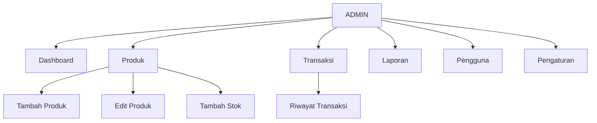
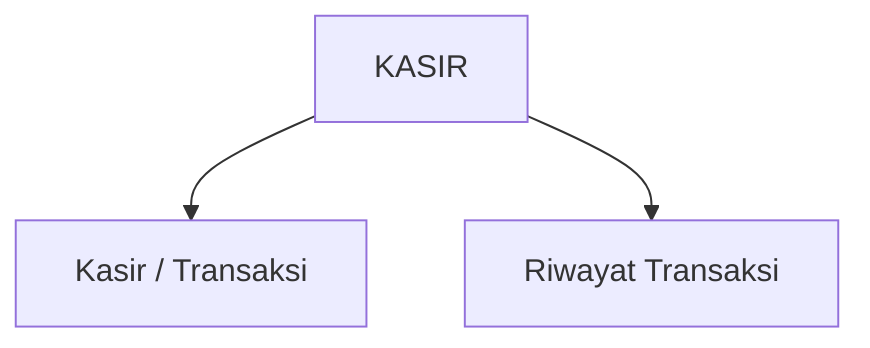
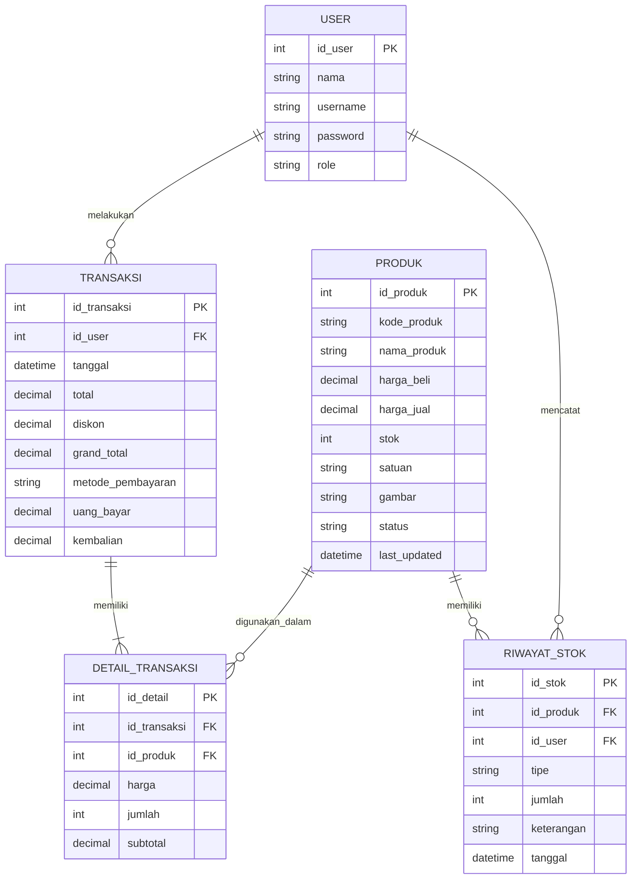

# PERANCANGAN SISTEM POINT OF SALES (POS)

## 1. Hirarki Menu Sidebar/Navbar

Aplikasi POS memiliki dua role pengguna, yaitu **Admin** dan **Kasir**.

### Struktur Menu

```text
POS TOKO
│
├── Login
│
├── Admin
│   ├── Dashboard
│   ├── Produk
│   │   ├── Tambah Produk
│   │   ├── Edit Produk
│   │   └── Tambah Stok
│   ├── Transaksi
│   │   └── Riwayat Transaksi
│   ├── Laporan
│   ├── Pengguna
│   └── Pengaturan
│
└── Kasir
    ├── Kasir / Transaksi
    └── Riwayat Transaksi
```

### Role Admin

Admin memiliki akses untuk mengelola data produk, stok, melihat transaksi, membuat laporan, mengelola pengguna, dan melakukan pengaturan sistem.



### Role Kasir

Kasir berfokus pada proses transaksi penjualan dan melihat riwayat transaksi yang telah dilakukan.



### Fungsi Setiap Menu

| Menu              | Role         | Fungsi                                            |
| ----------------- | ------------ | ------------------------------------------------- |
| Dashboard         | Admin        | Menampilkan ringkasan kondisi toko dan penjualan. |
| Produk            | Admin        | Melihat dan mengelola data produk.                |
| Tambah Produk     | Admin        | Menambahkan produk baru ke dalam sistem.          |
| Edit Produk       | Admin        | Mengubah informasi produk.                        |
| Tambah Stok       | Admin        | Menambahkan jumlah stok produk.                   |
| Transaksi         | Admin        | Melihat seluruh riwayat transaksi.                |
| Kasir / Transaksi | Kasir        | Melakukan transaksi penjualan pelanggan.          |
| Riwayat Transaksi | Admin, Kasir | Melihat transaksi yang telah terjadi.             |
| Laporan           | Admin        | Melihat ringkasan dan laporan penjualan.          |
| Pengguna          | Admin        | Mengelola akun pengguna dan role.                 |
| Pengaturan        | Admin        | Mengatur informasi dan konfigurasi toko.          |

---

## 2. Konsep ER-D Sederhana

Entity Relationship Diagram digunakan untuk menggambarkan entitas utama yang digunakan dalam sistem POS beserta hubungan antar-entitas.



## 3. Keterangan Entitas

| Entitas          | Fungsi                                                  |
| ---------------- | ------------------------------------------------------- |
| USER             | Menyimpan data pengguna sistem seperti Admin dan Kasir. |
| PRODUK           | Menyimpan data produk, harga, dan jumlah stok.          |
| TRANSAKSI        | Menyimpan data transaksi penjualan.                     |
| DETAIL_TRANSAKSI | Menyimpan rincian produk pada setiap transaksi.         |
| RIWAYAT_STOK     | Menyimpan perubahan stok produk.                        |

## 4. Relasi Utama

* **USER** dapat melakukan banyak **TRANSAKSI**.
* **TRANSAKSI** memiliki satu atau lebih **DETAIL_TRANSAKSI**.
* **PRODUK** dapat muncul pada banyak **DETAIL_TRANSAKSI**.
* **PRODUK** dapat memiliki banyak **RIWAYAT_STOK**.
* **USER** dapat mencatat banyak perubahan stok pada **RIWAYAT_STOK**.


LINK FIGMA: https://www.figma.com/design/KKI27Cf1VGj8yXBKoIL9vn/UI-UX-Aplikasi-POS?m=auto&t=UZwkqnCP5OzgcFZU-6
